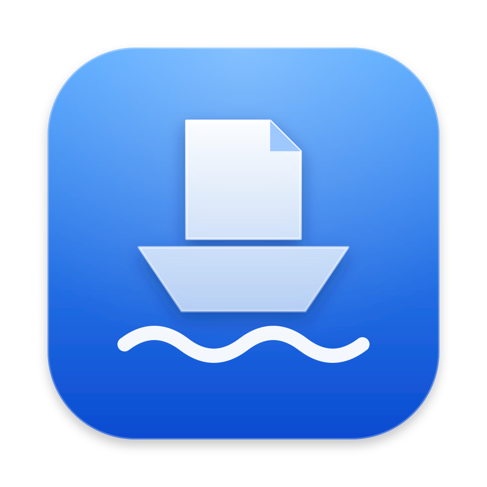

<div align="center">
  
  <h1>Ferry</h1>
  <p>A lightweight, native macOS Markdown editor built with SwiftUI and AppKit (TextKit 1), designed for copying text and inline images cleanly into desktop AI apps (Claude, ChatGPT, Codex, Antigravity, etc.).</p>
</div>

## Features

- **Inline Images & Lossless Markdown**: Renders local images inline with `ImageAttachment` while preserving original Markdown syntax on save (`MarkdownCodec`), and stores imported images in a document-adjacent `assets/` folder (`AssetStore`). Resize inline images via the bottom-right drag handle (with live width indicator) or right-click **Size** (`25%`, `50%`, `75%`, `Fit Width`) — custom widths save as `` and revert to `` on **Fit Width**, with lossless round-tripping for existing `` tags. Right-click also provides **Quick Look** (or double-click), **Reveal in Finder**, **Open Image**, and pixel-exact **Flip Horizontal** / **Flip Vertical** / **Rotate Left 90°** / **Rotate Right 90°** (`ImageTransform`, saving a new PNG into `assets/` without modifying the original file while preserving EXIF orientation and Retina DPI).
- **Live Syntax Highlighting**: Incremental CommonMark + GFM styling (`SyntaxHighlighter`) that never alters text and avoids restyling during IME composition, paired with Return list/task/quote continuation (`ListContinuation`).
- **Editing Ergonomics**: Opens documents with the editor focused; supports `⌘`-clicking links (`http`, `https`, `mailto`) or right-clicking for **Open Link** / **Copy Link** (even when syntax is hidden), clicking `[ ]`/`[x]` task checkboxes to toggle completion, `Tab`/`⇧Tab` list & multi-line indentation (preserving inline images), `⌘B`/`⌘I`/`⌘K` Markdown formatting, smart link paste (pasting an `http(s)` URL over selected text creates `[text](url)`), and `⌘=`/`⌘-`/`⌘0` text size zoom.
- **Safari Compact Tabs**: Single-row Safari-inspired compact tab bar (`SafariTabBar` + `TabWindowController` + `FerryDocument`) that stays completely hidden when only one file is open (showing a clean centered title bar with no tab strip or `+` button) and expands automatically when opening multiple documents (`⌘T`, `⌘O`, Finder, or Dock). Each tab preserves its own live editor, scroll position, selection, and per-document undo history, with hover `×` / unsaved dot `●`, drag-to-reorder, `⌘1`–`⌘9` / `⌃Tab` / `⇧⌘[` / `⇧⌘]` switching, `⌘W` / `⇧⌘W` close actions, and right-click menu (**Close Tab**, **Close Other Tabs**, **Move Tab to New Window**, **Reveal in Finder**).
- **Hide Markdown Syntax (`⌥⌘/`)**: Toggle hiding Markdown syntax symbols in the editor (`View` menu or `Ferry › Settings`), revealing the active cursor paragraph automatically without changing document text (`SyntaxHider`). Shortcut customizable in Settings.
- **Ignore Markdown Syntax When Copying (`⌥⇧⌘C`)**: Optional toggle (`Edit` menu or `Ferry › Settings`) to strip Markdown syntax for external apps (`MarkdownStripper`) while keeping lossless Markdown when pasting back into Ferry and via `⌥⌘C`. Shortcut customizable in Settings.
- **Rich Paste Import**: Preserves reading order of text and images from RTFD (Notes, Pages, TextEdit) and HTML (browsers, Notion, Word) via `RichClipboardReader` and `PasteImporter`, downloading remote web images in the background (`RemoteImageLoader`).
- **Three Copy Modes for Mixed Selections** (`Ferry › Settings`):
  - **Paste twice** *(default)*: Offers image files lazily on the first paste, then swaps the clipboard to text with `[Image N]` placeholders for the second paste (`TwoStepClipboard`).
  - **Paste once (.md + images)**: Attaches text as a `.md` file alongside image files for Chromium/Electron apps that ignore clipboard text when files are present (`FerryPasteboard` + `ClipboardAttachments`).
  - **One ⌘V**: Uses Accessibility (`CGEventTap` + background `AXUIElement` observation) to paste images one at a time, confirm each in the target UI, and then paste the text — never presses Return, never drops content, and learns per-app behavior (`AppPasteRules`). Also supports terminals (Terminal, iTerm2, Ghostty, Warp, WezTerm, Alacritty, Kitty, Hyper, Rio) by pasting each image as a shell-escaped file path for CLI AI tools (Codex CLI, Claude Code) followed by the text.
- **Plain Markdown Copy**: `⌥⌘C` copies plain relative-path Markdown directly to the clipboard.

## Project Structure

- `Ferry/App`: App entry point, native AppKit `NSDocument` (`FerryDocument`), multi-tab window controller (`TabWindowController`), Safari compact tab bar (`SafariTabBar`), toast, and settings UI.
- `Ferry/Editor`: TextKit 1 editor (`EditorTextView`), SwiftUI wrapper (`MarkdownEditor`), inline image attachment cell, and syntax highlighter.
- `Ferry/Model`: Markdown codec, asset store, image transforms, tab strip model (`TabStripModel`), pasteboard read/write, rich clipboard reader, remote image loader, list continuation, and two-step clipboard.
- `Ferry/Paste`: One ⌘V state machine (`OnePasteMachine`), controller, event tap, keystroke poster, AX observer/snapshot, attachment counter, and per-app rules.
- `FerryTests`: Unit tests covering Markdown syntax/codec, rich paste, copy/paste, two-step clipboard, app rules, attachment counting, and the One ⌘V state machine/controller.
- `design/`: App icon SVG masters, Icon Composer layers, and PNG previews.
- `scripts/`: Asset helper scripts (`make_icon.swift`).

## Building & Testing

### Requirements

- macOS 14.0+
- Xcode 15+
- Zero third-party Swift dependencies
- Optional: [XcodeGen](https://github.com/yonaskolb/XcodeGen) to regenerate `Ferry.xcodeproj` from `project.yml`, and `librsvg` (`rsvg-convert`) if running `swift scripts/make_icon.swift`.

### Build & Test

`project.yml` specifies a local `DEVELOPMENT_TEAM`; when building locally, override `DEVELOPMENT_TEAM` or adjust signing in Xcode / `project.yml` if needed:

```sh
xcodebuild -project Ferry.xcodeproj -scheme Ferry test CODE_SIGN_IDENTITY="" CODE_SIGNING_REQUIRED=NO
```
